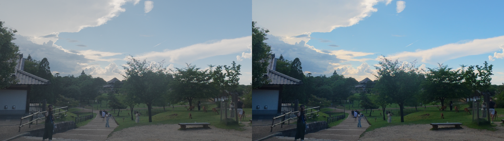

# DJI LogFix

把 DJI 相机拍的 **D-Log / D-Log M** 素材批量还原成正常色彩的 Rec.709 视频。

自带 ffmpeg 和官方 LUT，**离线可用**；带网页操作界面；**源素材全程只读**。

在 MacBook Air M2 / 8GB 上以 Osmo Action 5 Pro 的 4K50 HEVC 10bit 素材实测通过。

---

## 为什么需要它

DJI 的 Log 模式保留最大动态范围，方便后期调色，但**原片看起来是灰的**——
这是设计如此，不是拍坏了。要变成能直接看的正常画面，需要套用官方还原 LUT。

手上有几十上百个片段时，逐个拖进剪辑软件太慢，这个工具用来批量处理。

| 原始 D-Log M | 还原后 Rec.709 |
|---|---|
| 灰、低对比、低饱和 | 正常对比与色彩 |



---

## ⚠️ 关于两个 LUT 分类

`LUTs/` 下有两类，**用途完全不同，选错会偏色**：

| 分类 | 用在哪 |
|---|---|
| **`官方D-LogM/`** | ✅ **还原用**。输入是 D-Log M，输出 Rec.709 |
| **`官方风格化/`** | ❌ 输入要求是 **Rec.709**（梅/菊/竹/兰）。直接套在 Log 上会又暗又偏色 |

「风格化」那四个是**还原之后**再叠加的调色预设。界面上选中它们会弹警告。

---

## 使用

```bash
# 双击启动（macOS）
./启动.command
```

浏览器会自动打开 `http://127.0.0.1:8777/`，四步：

1. **选择素材** —— 选素材文件夹（递归查找视频），或选单个文件
2. **处理参数** —— 选 LUT、输出分辨率、画质；可拖滑块微调亮度/对比/饱和
3. **输出位置** —— 默认 `输出/`
4. **开始批量还原** —— 实时进度与日志

先点「**预览对比帧**」确认颜色对了，再批量跑。

### 命令行

```bash
# 列出内置 LUT
python3 djilogfix.py --list-luts

# 整个文件夹 → 1080p
python3 djilogfix.py "/path/to/DCIM/DJI_001" -o ~/Movies/Rec709 --height 1080

# 只看会执行什么，不实际转码
python3 djilogfix.py <路径> --dry-run

# 4K 原画质 + 保留陀螺仪数据轨（输出 .mov）
python3 djilogfix.py <路径> --height 2160 --keep-data
```

参数：`--height` `--quality` `--encoder` `--lut` `--brightness` `--contrast`
`--saturation` `--no-audio` `--keep-data` `--overwrite` `--dry-run`

---

## 性能（MacBook Air M2 / 8GB 实测）

| 场景 | 速度 | 1.79 小时素材 |
|---|---|---|
| 4K → 4K + LUT | 0.38× 实时 | 约 4.7 小时 |
| 4K → 1080p + LUT | 0.87× 实时 | 约 2.1 小时 |

**瓶颈是 4K 下的 LUT 运算，不是编码**（硬件编码几乎不占时间）。
所以降分辨率是最有效的提速手段。

几个已验证的加速点：

- `-hwaccel videotoolbox` 硬件解码：4K HEVC 10bit 解码从 27s/10s 素材 → 4s（约 7 倍）
- 先缩放再做 LUT 比反过来快很多
- `-filter_threads` 对 `lut3d` 这个瓶颈有效

---

## 安全性

**工具不会修改、移动、重命名或删除任何原始文件。** 具体做法：

- 源文件只以只读方式读取
- 输出统一写到独立目录，文件名加 `_Rec709` 后缀
- 输出目录与源目录相同时会弹确认
- 界面只监听 `127.0.0.1`，不对外网开放
- 磁盘空间不足会提前提示

---

## 已知限制

- 只处理视频，不碰照片（`.JPG` / `.DNG`）和 `.LRF` 代理文件
- 不做 HDR / Rec.2020 转换，只针对 D-Log / D-Log M → Rec.709
- 输出为 HEVC
- DJI 的 `djmd` 陀螺仪轨**装不进 MP4**，勾选保留时输出自动改为 `.mov`
- 目标分辨率**不会放大**超过源分辨率（1080p 素材选 4K 时保持原样）

---

## 文件结构

```
DJI-LogFix/
├── 启动.command          # 双击启动网页界面
├── webgui.py             # 网页界面
├── djilogfix.py          # 转码核心 + 命令行
├── tools/ffmpeg          # 内置静态 ffmpeg 7.1 (arm64)
├── LUTs/
│   ├── 官方D-LogM/       # 还原用
│   └── 官方风格化/       # 风格化用（Rec.709 输入）
├── 输出/                 # 默认输出（已 gitignore）
└── 说明.md               # 更详细的使用说明
```

---

## 环境要求

- macOS（Apple Silicon；Intel 需换用对应架构的 ffmpeg）
- Python 3.9+（系统自带即可，只用标准库）

只用了 Python 标准库，无需 `pip install` 任何依赖。

---

## 说明

- 内置的 `tools/ffmpeg` 是 [imageio-ffmpeg](https://github.com/imageio/imageio-ffmpeg) 提供的静态构建
- LUT 文件版权归 **DJI 大疆**所有，此处仅为方便使用而附带；
  如需商用或再分发，请以 DJI 官方许可为准
- 本项目与 DJI 无关联，非官方工具
